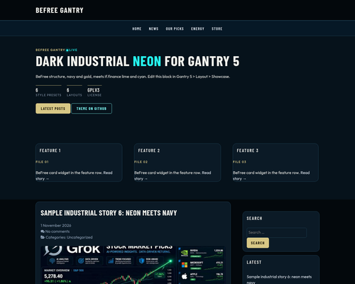
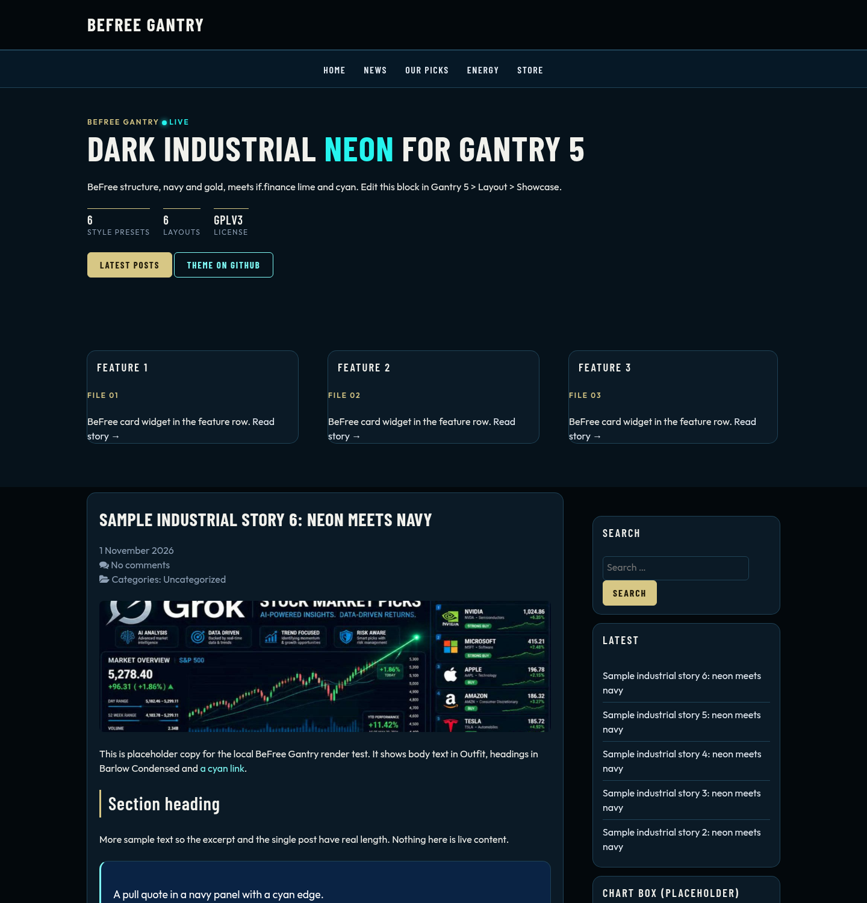

# BeFree Gantry

A dark, industrial **Gantry 5** theme for WordPress. It blends the **BeFree** look (navy, gold, Barlow Condensed, chamfered "industrial" cards) with the **if.finance** neon palette (lime "live" accents and cyan links).

* Version: **1.0.0**
* Requires: WordPress 6.0+, PHP 7.4+, and the free **[Gantry 5 Framework](https://gantry.org/) plugin** (5.6.x)
* License: **GNU GPL v3 or later** (see [License](#license))
* Read the launch story on if.finance: [BeFree Gantry: a dark, industrial WordPress theme](https://if.finance/befree-gantry-wordpress-theme/)


| Article | Mobile (390 px) | Industrial variant |
|---|---|---|
|  |  |  |

---

## Install

1. Install and activate the **Gantry 5 Framework** plugin (Plugins > Add New > search "Gantry 5"). BeFree Gantry does not work without it.
2. Download `befree-gantry-1.0.0.zip` from the GitHub release and check its SHA-256 against `befree-gantry-1.0.0.zip.sha256`.
3. In WordPress, go to **Appearance > Themes > Add New > Upload Theme**, pick the zip, then click **Install Now** and **Activate**.
4. Open **Gantry 5 > BeFree Gantry** to choose a style preset, layout and particles.
5. Optional: assign your menu in **Gantry 5 > Menu** or in the Menu particle, and add widgets to the `sidebar`, `aside`, `feature-1/2/3`, `subfeature` and `footer` positions.

Updates are manual. Upload the new zip and WordPress will offer to replace the theme. Your Gantry settings live in `wp-content/themes/befree-gantry/custom/` and are kept. This theme does not call home or use an update server.

## Style presets

Pick a preset in **Gantry 5 > Styles > Presets**. Every text and background pair passes WCAG AA (at least 4.5:1). The check is in [`tools/palettes.py`](tools/palettes.py).

| Preset | Thumbnail | Look | Lowest contrast |
|---|---|---|---|
| **Meld Neon** (default) |  | if.finance lime and cyan on BeFree dark industrial | 5.69:1 |
| **Industrial** |  | Hazard stripes, blueprint grid, chamfered cards, gold-plate titles, grayscale images | 5.69:1 |
| **BeFree Navy** |  | BeFree's own navy and gold | 6.69:1 |
| **Cyan Night** |  | Cyan leads, lime as the secondary accent | 5.69:1 |
| **Lime Terminal** |  | Lime leads on near-black, terminal style | 6.97:1 |
| **Light Paper** |  | Light surfaces on BeFree paper `#e7eef6`, with a navy nav and footer | 5.57:1 |

### Styles > BeFree Meld

Each preset fills a new **BeFree Meld** style section. You can also edit it directly:

| Setting | Purpose |
|---|---|
| Look | `Standard`, `Industrial` (hazard stripe, blueprint grid, chamfers, `.bf-stamp`) or `Light` |
| Card Radius | Corner radius for cards and panels (14px by default, 0px for Industrial) |
| Gold / Gold Text / Gold Button Text | Primary button, rules and eyebrow text. Keep Gold Text at 4.5:1 or better on Card |
| Card / Raised / Line | Card surface, image wells and borders |
| Muted / Navy / Paper / Ink | Secondary text, navy panels (blockquotes, `bf-navy`), nav labels and dark ink |

The standard Gantry sections (Base, Accent, Header, Navigation, Showcase, Feature, Main, Subfeature, Footer, Off-Canvas) still work as in Hydrogen. **Accent 1** is the lime "live" color and **Accent 2** is the cyan link color.

## Layout presets

Pick one in **Gantry 5 > Layout > Load**:

| Layout | Thumbnail | Structure |
|---|---|---|
| **Default** |  | Main (70%) and right sidebar (30%) with the Sister Site block |
| **Left Sidebar** |  | Sidebar (30%) and main (70%) |
| **Both Sidebars** |  | 22% / 56% / 22%, with the Sister Site block in the aside |
| **Full Width** |  | No sidebar. Sister Site in the subfeature row |
| **Magazine Home** |  | Showcase hero, 3-up feature grid (`feature-1..3`), main and sidebar, then subfeature. Used by the *Home* outline |
| **Offline** |  | Maintenance / offline page |
| **Error** |  | 404 / error page |

## Sister Site particle

Add **Sister Site** from the particle list, or use the copy already in the Default, Both Sidebars and Full Width layouts.


Fields: enabled, eyebrow, left/right pair labels, title and accented title part, URL and URL label, text, buttons (text, link, style `gold`/`ghost`/`neon`, target `_self`/`_blank`), note, hazard stripe on/off, and CSS class. All output is escaped. Links are plain `<a>` tags with no tracking, scripts or redirects, and `_blank` links get `rel="noopener noreferrer"`. The defaults point to `https://slopcore.army/` and `https://if.finance/slopcore/`, and you can change them in the particle settings.

## Fonts

**Barlow Condensed** (headings: 500, 600, 700) and **Outfit** (body: variable 400 to 600) ship as local **WOFF2** files in `befree-gantry/fonts/`. They are licensed under the [SIL Open Font License 1.1](befree-gantry/fonts/OFL.txt). The site makes no request to Google.

To load them from Google Fonts instead, open **Styles > Base** and pick *Barlow Condensed* and *Outfit* from the Google section of the Gantry font picker.

WOFF2 works in every current browser. No EOT, TTF or SVG fallbacks are included.

## Charts and TradingView widgets

Chart embeds are left as they are. The **only** CSS rule that touches them recolors the `.tradingview-widget-copyright` link to the footer text color (lime on hover). Custom HTML and Block widgets, where charts usually live, get no added padding, clipping or chamfers, so chart widths and heights stay as embedded.

## Local test (1.0.0)

These were rendered on WordPress (latest, SQLite integration), Gantry 5.6.4 and PHP 8.3, with the theme activated and Gantry SCSS compiled live. The sample images are test-only and are not shipped in the theme.

| Meld Neon home | Industrial home | Light Paper single |
|---|---|---|
|  |  |  |
| **BeFree Navy** | **Cyan Night** | **Lime Terminal** |
|  |  |  |
| **Layout: Left Sidebar** | **Layout: Both Sidebars** | **Layout: Full Width** |
|  |  |  |
| **Mobile 390 px** | **Layout: Default** | **404** |
|  |  |  |

## Repository layout

```
befree-gantry/     the installable theme (zip this folder)
  gantry/          theme.yaml, presets.yaml
  blueprints/      style and particle settings (styles/befree.yaml = BeFree Meld)
  layouts/         layout presets
  particles/       sister-site particle (.yaml + .html.twig)
  scss/            befree-gantry.scss, befree-gantry/_meld.scss, _sister.scss
  fonts/           Barlow Condensed + Outfit WOFF2, OFL.txt
docs/previews/     screenshots and thumbnails used in this README
tools/             build.sh (zip + sha256), palettes.py (WCAG check),
                   gen_presets.py, make_thumbs.py, wp_test.sh (local test helper)
```

To build, run `tools/build.sh`. It writes `dist/befree-gantry-<version>.zip` and a `.sha256` file.

## Credits

* **Gantry 5 Hydrogen** theme, Copyright (C) 2007 - 2022 Tiger12, LLC (originally created by RocketTheme, LLC). GNU GPL v2 or later. BeFree Gantry is a modified version of it.
* **Gantry 5 Framework**, Copyright (C) Tiger12, LLC / RocketTheme, LLC. MIT / GNU GPL v2 or later. It is a separate plugin and is not bundled.
* **Barlow Condensed**, Copyright 2017 The Barlow Project Authors. SIL OFL 1.1.
* **Outfit**, Copyright 2021 The Outfit Project Authors. SIL OFL 1.1.
* The BeFree palette and industrial styling were reimplemented from Intense Finance's own BeFree design. The if.finance neon palette is Intense Finance's own.
* No paid or "Pro" RocketTheme code is used.

## License

Copyright (C) 2026 Intense Finance. It is based on Hydrogen, Copyright (C) 2007 - 2022 Tiger12, LLC.

This program is free software: you can redistribute it and/or modify it under the terms of the GNU General Public License as published by the Free Software Foundation, either **version 3** of the License, or (at your option) any later version.

This program is distributed in the hope that it will be useful, but WITHOUT ANY WARRANTY; without even the implied warranty of MERCHANTABILITY or FITNESS FOR A PARTICULAR PURPOSE. See the GNU General Public License for more details. The full text is in [LICENSE](LICENSE).

Hydrogen is licensed "GPL v2 or later", which allows this version to be distributed under GPL v3 or later. The bundled fonts stay under the SIL Open Font License 1.1 ([`fonts/OFL.txt`](befree-gantry/fonts/OFL.txt)).
